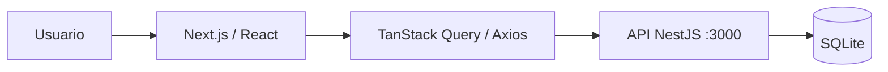

# Nexus Orders Dashboard — Panel de operaciones

Frontend experimental de **gestión de pedidos** desarrollado con **Next.js 16, React 19, TypeScript, TanStack Query, Axios y Tailwind CSS**. Funciona como interfaz para la API del repositorio [`nexus-orders-api`](https://github.com/andres-olguin/nexus-orders-api).

> **Estado:** prototipo de interfaz y flujo de pedidos. No es un producto de analítica comercial en producción; no existe evidencia de autenticación multiempresa validada ni de resultados comerciales reales.

## Funcionalidades presentes

- Listado de pedidos desde `GET /orders`.
- Formulario para registrar pedidos con cliente, producto, cantidad y precio unitario.
- Acción para marcar un pedido como completado mediante `PATCH /orders/:id/complete`.
- Actualización periódica de pedidos con TanStack Query.

La interfaz utiliza inicialmente una dirección fija para la API: `http://localhost:3000`. La configuración por variable de entorno `NEXT_PUBLIC_ORDERS_API_URL` está propuesta en el [PR #1](https://github.com/andres-olguin/nexus-orders-dashboard/pull/1), pero **ese cambio no forma parte del código principal mientras el PR esté abierto**.

## Arquitectura resumida



| Ruta | Contenido |
|---|---|
| [`src/app/page.tsx`](src/app/page.tsx) | Interfaz principal y flujos de pedidos |
| [`src/app/`](src/app/) | Aplicación y estilos |
| [`public/`](public/) | Recursos públicos |
| [`AGENTS.md`](AGENTS.md) | Convenciones de agentes y colaboración |
| [`DOCUMENTATION.md`](DOCUMENTATION.md) | Material técnico existente |
| [`docs/`](docs/) | Revisión, integración y planes de escalabilidad |

## Desarrollo local

**Requisitos:** Node.js compatible con Next.js 16 y npm. El dashboard debe ejecutarse en un puerto **distinto** de la API para evitar conflictos.

```bash
npm ci
npm run dev -- -p 3001
```

Abrir `http://localhost:3001` después de iniciar el backend por separado en `http://localhost:3000`.

**Bloqueo actual comprobado:** `npm ci` falla por inconsistencias de `package-lock.json` con paquetes `@emnapi/*`. Los comandos de desarrollo y compilación **no han sido validados en CI** desde ese bloqueo. Ver [issue #2](https://github.com/andres-olguin/nexus-orders-dashboard/issues/2) y [PR #1](https://github.com/andres-olguin/nexus-orders-dashboard/pull/1).

## Controles de calidad pendientes

- El código actual devuelve `[]` cuando falla la consulta HTTP, por lo que puede presentar falsamente una lista vacía en vez de un estado de error. Corregir antes de usar datos de negocio.
- Validar cliente/producto, cantidades y precios contra DTO del backend.
- Agregar estados vacíos, carga, reintento, errores y manejo accesible del formulario.
- Implementar autenticación/autorización acorde con la API, no solamente elementos de interfaz.
- Verificar CORS y contrato HTTP antes de intentar desplegar.
- Después de resolver el lockfile, ejecutar `npm run lint` y `npm run build` registrando resultados reales.

## Evolución prevista

Primero estabilizar la integración API/UI y las pruebas; después incorporar diseño responsive, permisos, accesibilidad y métricas reales. No introducir caches distribuidas ni otros servicios hasta medir necesidades.

[Plan de integración propuesto en PR #1](https://github.com/andres-olguin/nexus-orders-dashboard/pull/1) *(pendiente de integrar a main)* · [Estudio de arquitectura y escalabilidad](docs/ARCHITECTURE_SCALABILITY_2026-11-04.md).

**Uso:** laboratorio de software para operaciones comerciales; no utilizar datos de clientes reales antes de revisar seguridad y privacidad.
